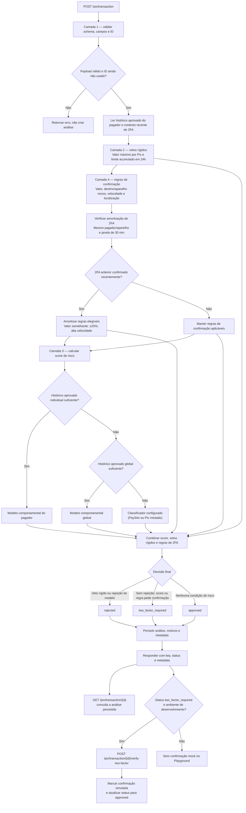

# Desafio Antifraude Pix — [Nome do grupo]

**Integrantes:** [nomes]

API REST em **Python + FastAPI** e **PostgreSQL**, construída a partir do
Base Service do Bootcamp QI Tech.

## Como o motor de decisão funciona

O `POST /pix/transaction` valida o contrato JSON, consulta o histórico do
pagador no PostgreSQL e calcula a decisão no controller. A análise e o
payload recebido ficam persistidos; `GET /pix/transaction/{id}` recupera
a decisão gravada. Não há consulta externa nem análise manual no caminho
da decisão.

O motor calcula `metadata.fraud_score` (0 a 1) como um indicador de risco
comportamental direcional. Com histórico aprovado suficiente, compara os
sinais da transação com até 30 transações anteriores do pagador; com
pouco histórico individual, usa distribuições direcionais globais de
transações aprovadas (até 200 registros); sem histórico global suficiente,
usa o classificador PaySim como fallback. O modelo individual só é usado
com pelo menos 50 transações aprovadas do pagador. No modelo comportamental,
valores maiores, intervalos menores, velocidades geográficas maiores e
aparelho novo podem elevar o risco. Valores menores, intervalos maiores e
velocidades menores são neutros: não aumentam nem compensam sinais
suspeitos. Horário incomum, por si só, também não altera esse score. Os
sinais positivos são combinados sem que um sinal benigno cancele outro.
Regras determinísticas continuam podendo escalar a decisão e os vetos de
limite continuam rejeitando.

### Diagrama do pipeline completo



O desenho mostra a ordem lógica de avaliação; as camadas 2, 3 e 4 são
calculadas durante a mesma análise. A decisão dá prioridade aos vetos
rígidos, depois à rejeição do modelo (exceto anomalia comportamental
individual, que pede 2FA), e então à exigência de confirmação. O
classificador configurado é fallback quando não há histórico comportamental
suficiente. A confirmação mock só existe em desenvolvimento e não representa
uma verificação real de identidade.

### Treinar e habilitar o modelo acadêmico

Baixe o CSV do [PaySim1 no Kaggle](https://www.kaggle.com/datasets/ealaxi/paysim1)
(arquivo `PS_20174392719_1491204439457_log.csv`) e instale as dependências
da aplicação. O arquivo contém dados sintéticos de dinheiro móvel; não
inclua o CSV nem o artefato treinado no Git.

```bash
python3 -m venv .venv
source .venv/bin/activate
pip install -r requirements-dev.txt
PYTHONPATH=src python -m train_paysim_model \
  --dataset /caminho/para/PS_20174392719_1491204439457_log.csv \
  --output artifacts/pix_fraud_model.joblib
docker compose up --build
```

O treino usa até 1 milhão de linhas (amostra aleatória reprodutível por
padrão), e imprime ROC AUC, average precision e Brier score em uma
partição de teste estratificada. O serviço lê o arquivo montado em
`/app/artifacts/pix_fraud_model.joblib`; ajuste `PIX_FRAUD_MODEL_PATH` se
usar outro local. O artefato PaySim é usado como fallback global quando
ainda não há histórico aprovado suficiente no banco. Se não existir esse
artefato nem histórico para treinar o perfil, `POST /pix/transaction`
responde HTTP 503 em vez de simular uma pontuação.

Os cortes iniciais são `PIX_TWO_FACTOR_THRESHOLD=0.30` e
`PIX_REJECT_THRESHOLD=0.70`. Valores abaixo do primeiro aprovam; do
primeiro até antes do segundo pedem 2FA; a partir do segundo rejeitam.
Uma regra local de maior severidade prevalece. Os cortes são parâmetros
acadêmicos configuráveis, não calibrados para risco financeiro real.

A regra de localização usa `PIX_MAX_LOCATION_SPEED_KMH` (padrão `900` no
Docker Compose). Calcula a distância de Haversine entre a geolocalização
atual e a da transação aprovada anterior do mesmo pagador nas últimas 24h,
dividida pelo tempo entre elas. Acima do limite, pede 2FA e inclui
`location_velocity` (distância, velocidade e limite) na metadata. Como
`geolocation` é opcional, a regra não roda sem coordenadas nas duas
transações. É um sinal experimental: GPS impreciso, spoofing e localização
compartilhada não são tratados.

O modelo comportamental não prevê o recebedor nem precisa de rótulos de
fraude. Ele mede separadamente quatro sinais: aumento do valor, redução
do intervalo entre transações, aumento da velocidade entre localizações
e uso de aparelho não visto no histórico. Os três primeiros comparam a
direção da mudança com a mediana e a dispersão histórica robusta; o
intervalo é medido em horas, com precisão de um minuto, e os valores são
transformados com `log1p`. Cada sinal tem score próprio em
`metadata.behavior_model.risk_signals`; eles são combinados sem que um
comportamento benigno (como valor menor ou intervalo maior) cancele um
sinal de risco. Horário incomum, por si só, não aumenta o score. O
destinatário é excluído do modelo comportamental; novidade de destino
continua coberta por regra determinística. Só transações aprovadas entram
no histórico individual. Esse perfil requer pelo menos 50 registros;
antes disso, a API compara com distribuições globais, desde que haja ao
menos 200 transações aprovadas disponíveis.

Após uma confirmação bem-sucedida de 2FA, durante 30 minutos no mesmo
pagador e aparelho, valores entre 75% e 125% do valor confirmado não acionam
novamente a regra `amount_requires_confirmation` nem elevam o sinal
comportamental `amount_increase`; nesse mesmo período, a regra
`high_transaction_velocity` também é amortizada no mesmo aparelho. Outros
sinais de risco e limites rígidos continuam ativos. A resposta registra as
regras amortizadas em `metadata.two_factor_amortization`.

Anomalia persistente não deve ficar automaticamente mais permissiva só
porque passou tempo: alguém pode esperar deliberadamente para contornar a
proteção. Uma alternativa mais segura é manter o score de risco e permitir
redução da fricção apenas após um sinal independente de legitimidade, como
2FA bem-sucedido ou confirmação autenticada no canal confiável. Repetições
sem validação podem aumentar a fricção ou acionar limites de tentativas,
em vez de reduzir o risco pelo simples decurso do tempo.

`fraud_score` é um score de risco direcional normalizado, não a
probabilidade de fraude. Um valor alto quer dizer que um ou mais sinais
suspeitos se afastam do padrão; ainda pode ser uma atividade legítima.
Os limiares `PIX_TWO_FACTOR_THRESHOLD` e `PIX_REJECT_THRESHOLD` transformam
esse score em 2FA/rejeição e devem ser calibrados para reduzir falsos
positivos antes de qualquer uso real. Essa lógica direcional vale para os
modelos comportamentais; sem histórico comportamental suficiente, o
classificador PaySim (ou um classificador Pix rotulado configurado) ainda
calcula seu score supervisionado próprio. Se o histórico individual não
atingir 50 registros, o modelo global não infere novidade de aparelho sem
histórico conhecido do pagador. Regras fixas de risco, como teto de valor e
velocidade de transações, continuam valendo independentemente do modelo.

A API registra em `metadata.model_features` os sinais derivados no
servidor, úteis para treinamento supervisionado futuro. O classificador
PaySim permanece somente como fallback global para cenários com pouco
histórico; ele usa apenas valor e hora e é um protótipo sintético, não
uma estimativa confiável de fraude Pix.

Quando houver dados Pix rotulados, crie um CSV com as colunas de
`metadata.model_features` — `amount_log_reais`, `hour_sin`, `hour_cos`,
`is_night`, `payer_account_age_days`, `prior_approved_count_24h`,
`prior_approved_amount_log_reais`, `prior_approved_count_10m`,
`has_prior_approved_history`, `is_new_destination`, `is_new_device`,
`location_speed_kmh` e `has_location_velocity` — e a coluna `is_fraud`
(`0` ou `1` por transação). Treine o modelo enriquecido assim:

```bash
PYTHONPATH=src python -m train_pix_model \
  --dataset /caminho/para/transacoes_pix_rotuladas.csv \
  --output artifacts/pix_fraud_model.joblib
```

O treino avalia os dados em uma partição estratificada e informa métricas
globais, além do recall no subconjunto de fraudes de até R$ 200 ao limiar
de 2FA. Confira a quantidade de fraudes de baixo valor e essas métricas
antes de usar o artefato: nenhuma mudança de features garante detectar
fraudes que não estejam representadas nos dados rotulados. O artefato
enriquecido é compatível com sinais calculados pela API; os modelos PaySim
legados continuam carregáveis para demonstração. Carregue apenas artefatos
confiáveis: arquivos Joblib podem executar código ao serem abertos.

## Regras

Valores monetários são centavos. Os limites abaixo são parâmetros
iniciais explícitos do time e podem ser recalibrados com dados reais.

| Regra | Lógica | Parâmetros | Por quê |
|---|---|---|---|
| Teto por transação | Reprova acima do limite | R$ 5.000 (`500000` centavos) | Interrompe uma saída individual muito alta antes da autorização. |
| Acumulado do pagador | Reprova se a soma das transações aprovadas nas últimas 24h mais a atual ultrapassar o limite | R$ 3.000 (`300000` centavos), janela móvel de 24h | Detecta fracionamento e exposição diária; só decisões `approved` anteriores compõem o total. |
| Valor elevado | Pede 2FA a partir do limite, inclusive | R$ 1.000 (`100000` centavos) | Acrescenta confirmação proporcional ao impacto financeiro. |
| Conta de destino recente | Pede 2FA se a conta recebedora tiver menos de 7 dias na data do Pix | 7 dias | Uma contraparte recém-aberta ainda tem pouco histórico observável. |
| Velocidade | Pede 2FA quando já existem pelo menos 3 Pix aprovados do pagador nos 10 minutos anteriores | Janela móvel de 10 min; o atual é o 4º | Captura rajadas incompatíveis com o ritmo normal. |
| Deslocamento impossível | Pede 2FA se a velocidade estimada entre a última geolocalização aprovada e a atual exceder o limite | Padrão: 900 km/h; histórico de 24h; requer coordenadas nas duas transações | Sinaliza posições incompatíveis com deslocamento físico plausível. |
| Novo destino ou dispositivo | Para pagador com Pix aprovado nas últimas 24h, pede 2FA se o destino (ISPB, agência e conta) ou aparelho não aparece nesse perfil | Perfil de 24h | Usa a familiaridade da contraparte e do aparelho sem fricção no primeiro uso do cliente. |

## Como as regras viram decisão

1. Qualquer teto excedido resulta em `rejected`.
2. Sem reprovação, uma ou mais regras de confirmação resultam em
   `two_factor_required`.
3. Sem regra acionada, o Pix recebe `approved`.

`metadata.reasons` lista os motivos por identificadores estáveis (por
exemplo, `amount_requires_confirmation`); `no_risk_rules_triggered`
explica uma aprovação sem alertas. Toda análise recebida, inclusive
reprovada ou pendente de 2FA, é registrada. Um `id` já analisado não é
processado novamente e retorna HTTP 409.

## Contrato Pix

As rotas Pix exigem o cabeçalho `INTERNAL-TOKEN` herdado do Base Service.
Os campos e objetos aninhados do endpoint de análise são validados por
`src/schemas/post_pix_transaction.json`; datas devem incluir fuso
horário. `geolocation` é opcional.

```bash
curl -X POST http://localhost:3000/pix/transaction \
  -H "INTERNAL-TOKEN: default_token" \
  -H "Content-Type: application/json" \
  -d '{
    "id": "pix-000123",
    "amount": 150000,
    "transaction_date": "2026-10-17T22:15:00-03:00",
    "source_account": {
      "branch": "0001",
      "account_number": "88213",
      "opening_date": "2025-03-02T10:00:00-03:00",
      "owner": {"document_number": "123.456.789-09"}
    },
    "destination_account": {
      "participant": "60701190",
      "branch": "3675",
      "account_number": "10442",
      "opening_date": "2026-10-10T09:00:00-03:00",
      "owner": {"document_number": "987.654.321-00"}
    },
    "source": {
      "device_id": "dvc-9f2c71a8",
      "channel": "app",
      "ip": "198.51.100.23",
      "geolocation": {"latitude": -23.56, "longitude": -46.65}
    }
  }'
```

Resposta:

```json
{
  "key": "b3f1c2e0-7d4a-4c1e-9a52-1f0e6c9d2a77",
  "status": "two_factor_required",
  "metadata": {
    "fraud_score": 0.42,
    "decision_layer": "payer_behavior_anomaly",
    "reasons": [
      "amount_requires_confirmation",
      "model_fraud_score_requires_confirmation"
    ],
    "triggered_rules": ["amount_requires_confirmation"],
    "score_source": "payer_approved_history",
    "behavior_model": {
      "scope": "payer_behavior_anomaly",
      "history_transactions": 42,
      "risk_signal_names": [
        "amount_increase",
        "shorter_transaction_interval",
        "higher_travel_speed",
        "new_device"
      ],
      "risk_signals": {
        "amount_increase": 0.0,
        "shorter_transaction_interval": 0.0,
        "higher_travel_speed": 0.0,
        "new_device": 0.4
      }
    }
  }
}
```

Consulte a análise gravada usando o mesmo `id` enviado:

```bash
curl http://localhost:3000/pix/transaction/pix-000123 \
  -H "INTERNAL-TOKEN: default_token"
```

Para testar o fluxo de verificação, envie um POST sem corpo para:

```bash
curl -X POST http://localhost:3000/pix/transaction/pix-000123/verify-two-factor \
  -H "INTERNAL-TOKEN: default_token"
```

A rota só aceita análises com status `two_factor_required`; ela grava em
`metadata.two_factor_verification` o status `verified`, o horário e o método
`development_simulation`. Em `APP_ENV=local`, `dev`, `development` ou `test`,
a confirmação simulada também muda o status para `approved`; chamadas repetidas
são idempotentes. Em qualquer outro ambiente, a rota responde HTTP 403.
Isso é apenas uma conveniência para testes, não uma verificação real de
identidade nem uma liquidação Pix. Como o `INTERNAL-TOKEN` autentica apenas o
serviço chamador, qualquer integração de produção precisará validar um
desafio/OTP confiável antes de aprovar a transação.

No Playground, quando o ambiente permite a simulação, uma análise pendente de
2FA exibe uma única ação, **Confirmar 2FA mock (dev)**, mesmo que mais de um
motivo da camada 4 tenha sido acionado. A ação apenas simula a conclusão do
desafio e não representa uma verificação real de identidade.

## Desenvolvimento

### Iniciar a API e o Playground

```bash
docker compose up --build
```

A API fica em `http://localhost:3000`; o Playground, em
[http://localhost:3000/playground](http://localhost:3000/playground).
Use-o para enviar exemplos, escolher pagador/dispositivo/destino e consultar
análises; perfis de teste ficam salvos neste navegador.
Use `INTERNAL-TOKEN` (padrão local: `default_token`) nos endpoints internos.
Para desligar, pressione `Ctrl+C` e execute `docker compose down`.

### Testes

Com API e banco ativos, instale e rode os testes no ambiente Python local:

```bash
python3 -m venv .venv
source .venv/bin/activate
pip install -r requirements-dev.txt
pytest
```

No Windows, ative o ambiente com `.venv\Scripts\activate`.

### Métricas locais de desempenho

Com a API e o banco ativos, rode um benchmark HTTP do endpoint de análise Pix:

```bash
python3 scripts/benchmark_api.py --requests 100 --concurrency 5
```

O script informa latências p50/p95/p99, throughput, taxa de sucesso, códigos
HTTP e ambiente da máquina. Cada requisição analisa e persiste uma transação
com ID único; portanto, o teste acrescenta dados ao banco local. Os resultados
são específicos da máquina e do modo de desenvolvimento do Compose (`--reload`):
servem como medição reproduzível para apresentação, não como SLA ou garantia
de desempenho em produção.

### Banco de dados

O schema inicial está em `database/database.sql` e é aplicado quando o
volume do PostgreSQL é criado. Para bancos antigos, aplique a migração de
remoção das colunas não utilizadas:

```bash
docker compose exec -T db psql -U bootcamp -d bootcamp \
  < database/migrations/20261018_drop_unused_created_at_columns.sql
```

A migração de `amount` para `BIGINT`, necessária somente se a tabela Pix
existente ainda usar `INTEGER`, é:

```bash
docker compose exec -T db psql -U bootcamp -d bootcamp \
  -c "ALTER TABLE pix_transaction ALTER COLUMN amount TYPE BIGINT"
```

`docker compose down -v` recria o banco do zero, mas apaga todos os dados
do volume; use apenas no banco descartável de desenvolvimento.

## Rotas

| Rota | Uso |
|---|---|
| `GET /` e `GET /health_check` | informações do serviço e healthcheck |
| `GET /playground` | interface local de simulação |
| `POST /pix/transaction` | analisa e persiste um Pix |
| `GET /pix/transaction/{id}` | consulta análise pelo ID da transação |
| `POST /pix/transaction/{id}/verify-two-factor` | confirmação mock, somente em desenvolvimento |

As rotas internas exigem o header `INTERNAL-TOKEN`. A confirmação de 2FA
em desenvolvimento é apenas um mock: não verifica a identidade do pagador
nem liquida o Pix.

## Configuração principal

Os valores abaixo são os padrões do Docker Compose; portas e limiares podem
ser sobrescritos no arquivo local `.env` (crie-o a partir de
`.env.example`).

| Variável | Padrão | Finalidade |
|---|---:|---|
| `API_PORT` | `3000` | porta local da API |
| `DB_PORT` | `5432` | porta local do PostgreSQL |
| `INTERNAL_TOKEN` | `default_token` | autenticação das rotas internas |
| `PIX_TWO_FACTOR_THRESHOLD` | `0.30` | score a partir do qual se pede 2FA |
| `PIX_REJECT_THRESHOLD` | `0.70` | limiar de rejeição do modelo |
| `PIX_MAX_LOCATION_SPEED_KMH` | `900` | velocidade estimada que aciona 2FA |
| `PIX_FRAUD_MODEL_PATH` | `artifacts/pix_fraud_model.joblib` | artefato usado pelo classificador fallback |

Nunca use os tokens padrão fora do ambiente local de estudo.

## Estrutura

- `src/resources/`: endpoints HTTP.
- `src/controllers/`: regras de negócio e pipeline antifraude.
- `src/repositories/`: consultas e gravações no PostgreSQL.
- `src/models/` e `database/database.sql`: mapeamento ORM e schema.
- `src/behavior_model.py` e `src/fraud_model.py`: score comportamental e
  combinação das decisões.
- `src/schemas/`: validação dos payloads.
- `tests/`: testes unitários e de integração.

## Problemas comuns

- **Porta ocupada:** defina `API_PORT` ou `DB_PORT` no `.env`. Se mudar a
  porta do banco, atualize também `DATABASE_URL` usada pelos testes locais.
- **Docker indisponível:** inicie o Docker Desktop ou o serviço Docker.
- **Tabela inexistente após editar o SQL:** o schema inicial só roda ao
  criar o volume; aplique a migração apropriada ou recrie o volume sabendo
  que isso apaga os dados locais.
- **Ver logs da API:** `docker compose logs -f api`.

## Licença

Este projeto usa a licença MIT; consulte o arquivo `LICENSE`.
